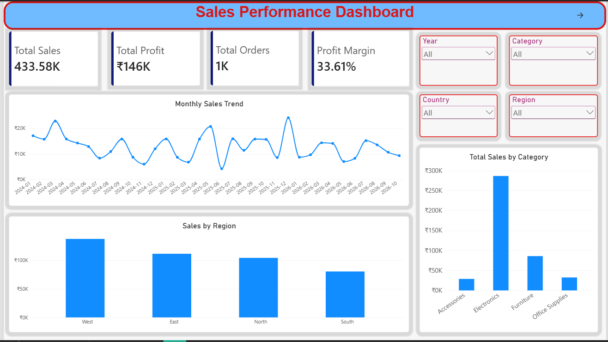
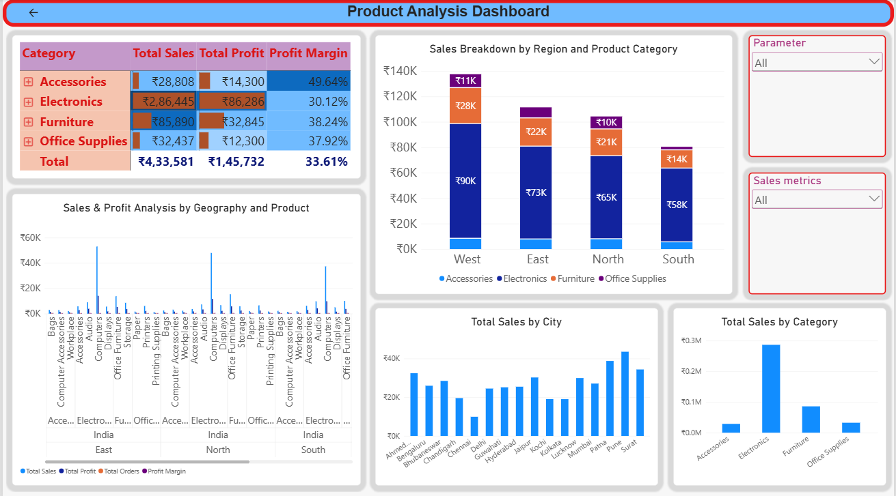

**📊 Product Sales Analysis Dashboard | Power BI**

**Project Overview**

The Product Sales Analysis Dashboard is an interactive business intelligence project developed using Microsoft Power BI. This project focuses on analyzing sales performance, product trends, customer behavior, regional performance, and profitability to generate meaningful business insights.

**Project Objectives**

- Analyze overall sales and profit performance.
- Identify top-performing products and categories.
- Understand regional sales distribution.
- Analyze customer purchasing patterns.
- Monitor product inventory.
- Support data-driven business decisions.

**Tools & Technologies**

- Microsoft Power BI
- Power Query
- DAX (Data Analysis Expressions)
- Microsoft Excel
- Data Modeling
- Data Visualization

**📈 Dashboard Features**

- KPI Cards
- Sales Performance Analysis
- Product Analysis
- Category-wise Sales Analysis
- Regional Sales Analysis
- Customer Analysis
- Interactive Slicers
- Drill-Down and Drill-Through
- Conditional Formatting

**📊 Key Performance Indicators**

- Total Sales
- Total Profit
- Total Orders
- Total Quantity Sold
- Profit Margin
- Sales Growth

**📁 Project Files**

- `Product Sales Analysis.pbix` – Power BI dashboard.
- `Sales_Performance_Dataset.xlsx` – Source dataset.

**🚀 How to Run the Project**

1. Download the repository.
2. Open the `.pbix` file using Microsoft Power BI Desktop.
3. Update the Excel source path if required.
4. Refresh the data.
5. Explore the interactive dashboard.

**🎓 Key Learnings**

- Data cleaning and transformation using Power Query.
- Data modeling and table relationships.
- Creating DAX measures.
- Designing interactive dashboards.
- Implementing slicers and drill-through functionality.
- Generating business insights through visualization.

**📸 Dashboard Preview**
**1. Sales Overview Dashboard**

**2. Product Analysis Dashboard**

**👨‍💻 Author**

**Suresh Kumar A**

⭐ If you find this project useful, feel free to star the repository!

---
